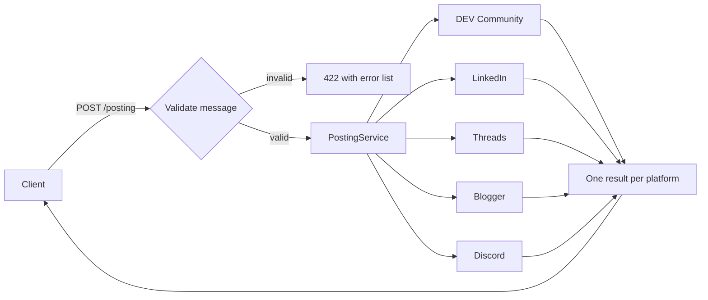

# Automated Multi-Platform Posting System

A Python 3 and FastAPI service built for the Dxora Technologies practical test. A single API call publishes a short message to five well-known platforms through their official APIs. The response reports what happened on each platform: the link to the post, whether it is public, and when it was posted.

```bash
curl -X POST http://localhost:4000/posting \
  -H "Content-Type: application/json" \
  -d '{"message": "Check out our latest business platform and grow your online visibility. https://example.com"}'
```

## Contents

- [How it works](#how-it-works)
- [Platforms](#platforms)
- [API](#api)
- [Error handling](#error-handling)
- [Project structure](#project-structure)
- [Setup](#setup)
- [Run](#run)
- [Tests](#tests)
- [Sample run](#sample-run)
- [Security](#security)

## How it works



1. The client sends a message to `POST /posting`.
2. The message is validated. It must be 200 characters or fewer and contain exactly one valid CTA link.
3. The server chooses the platforms. The client only sends the message.
4. The message is published to all five platforms at the same time with `asyncio.gather`.
5. Each platform is isolated. If one fails, times out, or is missing credentials, the others still post and the failure is reported in its own result.
6. The response lists, for each platform, the status, the published URL, whether the post is public, the date and time, and any error.

## Platforms

I chose platforms that meet three conditions:

- **Well known**, with an **official, documented API** for creating posts.
- **Free** to post to, with no paid tier or manual approval.
- **Returns a link** to the published content, so every result can be checked.

| Platform | Type | API | Auth | Why it was chosen |
|---|---|---|---|---|
| [DEV Community](https://dev.to) | Developer blogging | Forem REST API: `POST /api/articles` | API key header | A large developer community. A personal API key is enough, and articles are public and indexed by search engines. |
| [LinkedIn](https://www.linkedin.com) | Professional network | Posts API: `POST /rest/posts` | OAuth 2.0 (`w_member_social`) | The main professional network. "Share on LinkedIn" is self-serve, so posting to your own profile needs no review. |
| [Threads](https://www.threads.com) | Social network | Threads API: create a container, then `threads_publish` | OAuth 2.0 (`threads_content_publish`) | Meta's text-first network. A development-mode app can post to its tester's account without App Review. |
| [Blogger](https://www.blogger.com) | Blogging (Google) | Blogger API v3: `POST /blogs/{id}/posts` | Google OAuth 2.0 with a refresh token | A long-running Google platform. The API is free, and posts go live on a public blog. |
| [Discord](https://discord.com) | Community chat | Webhooks: `POST /webhooks/{id}/{token}` | Webhook URL | Widely used for community announcements. Webhooks need no bot and no OAuth. |

How each platform shows the message:

- **DEV Community and Blogger** need a title. A short title is built from the message text, without the link.
- **Blogger** turns the CTA link into a clickable `<a>` tag.
- **LinkedIn** escapes characters that are reserved in its "little text" format, such as `(`, `)`, and `_`, so they show as written.
- **Threads** attaches the CTA link as a link preview.
- **Discord** posts as "Multi-Platform Poster" and turns off `@everyone` pings.
- **Discord** reports `public_access: false`. A Discord message can only be seen by members of the server, so it is not publicly accessible, and the response says so.

Credential setup for each platform is described step by step in [docs/platform-setup.md](docs/platform-setup.md).

### Platforms considered but not used

| Platform | Reason |
|---|---|
| X (Twitter) | Posting through the API requires buying pay-per-use credits. |
| Reddit | New API access needs manual approval under the Responsible Builder Policy (since November 2025). |
| Medium | Medium no longer issues integration tokens, and the API is unsupported. |
| Hashnode | The GraphQL API requires a paid Pro plan (since May 2026). |
| Instagram | Every post must include an image, and it requires a business account. |
| Facebook Pages | Posts from an app in development mode may be visible only to people with a role on the app. |
| Telegram, Tumblr, Pastebin | Free, but not reachable from the development network. |

## API

| Method | Path | Description |
|---|---|---|
| `POST` | `/posting` | Validate the message and publish it to every platform |
| `GET` | `/platforms` | List the platforms and whether their credentials are set (values are never shown) |
| `GET` | `/health` | Check that the service is running |
| `GET` | `/docs` | Interactive Swagger documentation |

### `POST /posting`

```http
POST http://localhost:4000/posting
Content-Type: application/json

{
  "message": "Check out our latest business platform and grow your online visibility. https://example.com"
}
```

#### Validation

| Rule | Error message |
|---|---|
| `message` is required | `This field is required.` |
| `message` must be a string | `Input should be a valid string` |
| `message` is not empty or only spaces | `Must not be empty.` |
| `message` is 200 characters or fewer | `Must not exceed 200 characters.` |
| `message` contains a link | `Message must include one CTA link starting with http:// or https://.` |
| `message` contains exactly one link | `Message must include exactly one CTA link, but 2 were found.` |
| The link uses `http` or `https` | `'ftp://example.com' must start with http:// or https://.` |
| The link has a real domain name | `'https://localhost' does not have a valid domain name.` |
| No other fields are sent | `Unexpected field. Platforms are selected by the server, so only 'message' is accepted.` |
| The body is valid JSON | `Request body is not valid JSON.` |

Some details of how links are handled:

- Leading and trailing spaces are removed before the length is checked.
- Punctuation that ends a sentence, as in `Visit https://example.com.`, is not treated as part of the link.
- A bare `www.example.com` counts as a link, but it is rejected because it has no scheme.

Invalid input returns `422 Unprocessable Content`:

```json
{
  "success": false,
  "errors": [
    { "field": "message", "message": "Message must include exactly one CTA link, but 2 were found." }
  ]
}
```

#### Response

The endpoint returns `200 OK` once every platform has been tried.

| Field | Description |
|---|---|
| `success` | `true` when at least one platform published the message |
| `results[].platform` | Platform name |
| `results[].status` | `success` or `failed` |
| `results[].posted_url` | URL of the published content |
| `results[].public_access` | Whether the content is publicly accessible |
| `results[].date` | Posting date (`YYYY-MM-DD`) |
| `results[].time` | Posting time (`HH:MM:SS`), in `APP_TIMEZONE` |
| `results[].error` | Error details, if the post failed |

```json
{
  "success": true,
  "results": [
    {
      "platform": "DEV Community",
      "status": "success",
      "posted_url": "https://dev.to/<user>/<article-slug>",
      "public_access": true,
      "date": "2026-11-22",
      "time": "18:42:07",
      "error": null
    },
    {
      "platform": "Discord",
      "status": "failed",
      "posted_url": null,
      "public_access": false,
      "date": null,
      "time": null,
      "error": "Not configured. Missing: DISCORD_WEBHOOK_URL"
    }
  ]
}
```

The output from a real run is in [Sample run](#sample-run).

### `GET /platforms`

```json
[
  { "platform": "DEV Community", "configured": true, "missing_settings": [] },
  { "platform": "Blogger", "configured": false, "missing_settings": ["BLOGGER_REFRESH_TOKEN"] }
]
```

## Error handling

Every platform call runs inside its own error boundary, so a failure becomes a `failed` result instead of an exception:

| Situation | `error` value |
|---|---|
| Credentials missing | `Not configured. Missing: THREADS_ACCESS_TOKEN` |
| Platform rejects the request | `HTTP 401: <the platform's own error message>` |
| Platform accepts the request but returns no link | e.g. `LinkedIn accepted the post but did not return its ID.` |
| Request takes longer than `REQUEST_TIMEOUT_SECONDS` | `The platform did not respond in time.` |
| DNS failure, refused connection, or TLS error | `Network error: ConnectError` |
| Anything unexpected | `Unexpected error. Check the server logs for details.` The full traceback is logged. |

Some platforms need extra handling:

- **Threads** retries the publish step when Meta reports that a new post is still processing.
- **Blogger** caches its Google access token until shortly before it expires.

## Project structure

```text
app/
├── main.py                  # App factory, lifespan, validation error handler, /health
├── config.py                # Settings loaded from environment variables
├── logging_config.py        # Console and optional file logging
├── schemas.py               # Request validation and response models
├── routers/
│   └── posting.py           # POST /posting and GET /platforms
├── services/
│   └── posting_service.py   # Publishes to every platform concurrently
├── platforms/
│   ├── __init__.py          # Platform registry
│   ├── base.py              # Shared interface, errors, and response parsing
│   ├── devto.py
│   ├── linkedin.py
│   ├── threads.py
│   ├── blogger.py
│   └── discord.py
└── utils/
    └── text.py              # Link detection, URL checks, title building
docs/
└── platform-setup.md        # How to get credentials for each platform
tests/
├── conftest.py              # Test settings and HTTP mocking
├── test_validation.py
├── test_posting.py
└── test_endpoints.py
```

Design notes:

- **One class per platform.** Each implements `publish()` and lists the settings it needs. The posting service does not depend on any platform's details. To add a platform, write a class and add it to `PLATFORM_CLASSES` in `app/platforms/__init__.py`.
- **One shared HTTP client.** The `httpx.AsyncClient` is created when the app starts and closed when it shuts down, so connections are reused across platforms.
- **Testable app factory.** `create_app(settings)` lets the tests run the real app with fake credentials and mocked HTTP.

## Setup

Requires Python 3.11 or later.

```bash
git clone https://github.com/hammaddq/automated-multi-platform-posting-system-muhammad-hammad.git
cd automated-multi-platform-posting-system-muhammad-hammad
python3 -m venv .venv
source .venv/bin/activate
pip install -r requirements.txt
cp .env.example .env
```

Fill in `.env` using [docs/platform-setup.md](docs/platform-setup.md). A platform without credentials is reported as `failed`, and the rest still post.

| Variable | Description |
|---|---|
| `APP_TIMEZONE` | Time zone for `date` and `time` in results, e.g. `Asia/Karachi`. Default is `UTC`. |
| `REQUEST_TIMEOUT_SECONDS` | Timeout for each platform call. Default is `15`. |
| `LOG_FILE` | Optional path for a log file, e.g. `logs/posting.log` |
| `DEVTO_API_KEY` | DEV Community API key |
| `LINKEDIN_ACCESS_TOKEN`, `LINKEDIN_PERSON_URN` | LinkedIn member token and `urn:li:person:<id>` |
| `LINKEDIN_API_VERSION` | LinkedIn API version header in `YYYYMM` format |
| `THREADS_ACCESS_TOKEN`, `THREADS_USER_ID` | Threads long-lived token and user ID |
| `BLOGGER_CLIENT_ID`, `BLOGGER_CLIENT_SECRET`, `BLOGGER_REFRESH_TOKEN`, `BLOGGER_BLOG_ID` | Google OAuth client, refresh token, and target blog |
| `DISCORD_WEBHOOK_URL` | Channel webhook URL |

## Run

```bash
uvicorn app.main:app --host 0.0.0.0 --port 4000
```

- Interactive API docs: http://localhost:4000/docs
- Configuration check: http://localhost:4000/platforms

## Tests

```bash
pytest
```

The 28 tests mock every platform API with [respx](https://lundberg.github.io/respx/), so they run offline and never publish anything. They cover:

- each validation rule;
- a successful post to all five platforms;
- one platform failing while the others succeed;
- every platform failing;
- timeouts and network errors;
- missing credentials;
- how each platform formats its request, including LinkedIn escaping, Blogger HTML, the Threads auth header, and the Discord payload;
- the `/platforms` and `/health` endpoints.

## Sample run

_The response and server log from a real run will be added here._

## Security

- Credentials are read only from environment variables or the local `.env` file. `.env` is ignored by Git, and `.env.example` has empty values.
- Tokens are never placed in URLs. The Threads token is sent as an `Authorization` header instead of the `access_token` query parameter.
- `httpx` request logging is muted, because Discord webhook URLs contain a secret token.
- `/platforms` lists only the names of missing settings, never their values.

## Author

**Muhammad Hammad**

- Phone — [+92 303 0277069](tel:+923030277069)
- Email — [qureshihammad6767@gmail.com](mailto:qureshihammad6767@gmail.com)
- Portfolio — [hammadq.site](https://hammadq.site)
