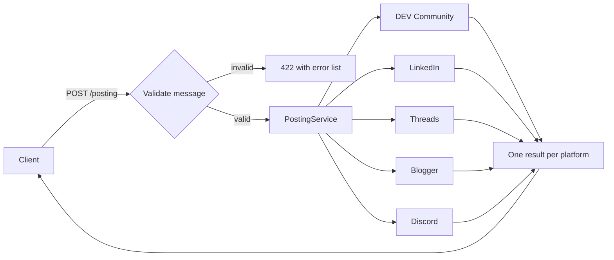

# Automated Multi-Platform Posting System

A Python 3 and FastAPI service built for the Dxora Technologies practical test. A single API call publishes a short message to five well-known platforms through their official APIs. The response reports what happened on each platform: the link to the post, whether it is public, and when it was posted.

```bash
curl -X POST http://localhost:4000/posting \
  -H "Content-Type: application/json" \
  -d '{"message": "Check out our latest business platform and grow your online visibility. https://example.com"}'
```

This README is the complete guide to the project: what it does, how it is built, how to set it up from scratch, and how to run and test it. Results from a live run are in [docs/work-report.pdf](docs/work-report.pdf).

## Contents

1. [Overview](#1-overview)
2. [Platforms](#2-platforms)
3. [Quick start](#3-quick-start)
4. [Configuration](#4-configuration)
5. [Getting platform credentials](#5-getting-platform-credentials)
6. [Running the service](#6-running-the-service)
7. [Using the API](#7-using-the-api)
8. [Error handling](#8-error-handling)
9. [Architecture](#9-architecture)
10. [Testing](#10-testing)
11. [Live run results](#11-live-run-results)
12. [Troubleshooting](#12-troubleshooting)
13. [Security](#13-security)
14. [Author](#14-author)

## 1. Overview



1. The client sends a message to `POST /posting`.
2. The message is validated. It must be 200 characters or fewer and contain exactly one valid CTA link.
3. The server chooses the platforms; the client only sends the message.
4. The message is published to all five platforms at the same time with `asyncio.gather`.
5. Each platform is isolated. If one fails, times out, or is missing credentials, the others still post, and the failure appears in that platform's own result.
6. The response lists, for each platform, the status, the published URL, whether the post is public, the date and time, and any error.

**Tech stack:** Python 3.11+, FastAPI, Uvicorn, Pydantic v2, pydantic-settings, HTTPX (async), pytest, and respx.

## 2. Platforms

I chose platforms that meet three conditions:

- **Well known**, with an **official, documented API** for creating posts.
- **Free** to post to, with no paid tier or manual approval.
- **Returns a link** to the published content, so every result can be checked.

| Platform | Type | API | Auth | Why it was chosen |
|---|---|---|---|---|
| [DEV Community](https://dev.to) | Developer blogging | Forem REST API: `POST /api/articles` | API key header | A large developer community. A personal API key is enough, and articles are public and indexed by search engines. |
| [LinkedIn](https://www.linkedin.com) | Professional network | Posts API: `POST /rest/posts` | OAuth 2.0 (`w_member_social`) | The main professional network. "Share on LinkedIn" is self-serve, so posting to your own profile needs no review. |
| [Threads](https://www.threads.com) | Social network | Threads API: create a container, then `threads_publish` | OAuth 2.0 (`threads_content_publish`) | Meta's text-first network. A development-mode app can post to its tester's account without App Review. |
| [Blogger](https://www.blogger.com) | Blogging (Google) | Blogger API v3: `POST /blogs/{id}/posts` | Google OAuth 2.0 with a refresh token | A long-running Google platform. The API is free, and posts go live on a public blog. |
| [Discord](https://discord.com) | Community chat | Webhooks: `POST /webhooks/{id}/{token}` | Webhook URL | Widely used for community announcements. Webhooks need no bot and no OAuth. |

### How each platform shows the message

- **DEV Community and Blogger** need a title. A short title is built from the message text, without the link.
- **Blogger** turns the CTA link into a clickable `<a>` tag.
- **LinkedIn** escapes characters that are reserved in its "little text" format, such as `(`, `)`, and `_`, so they show as written.
- **Threads** attaches the CTA link as a link preview.
- **Discord** posts as "Multi-Platform Poster" and turns off `@everyone` pings.
- **Discord** reports `public_access: false`. A Discord message can only be seen by members of the server, so it is not publicly accessible, and the response says so.

### Platforms considered but not used

| Platform | Reason |
|---|---|
| X (Twitter) | Posting through the API requires buying pay-per-use credits. |
| Reddit | New API access needs manual approval under the Responsible Builder Policy (since November 2025). |
| Medium | Medium no longer issues integration tokens, and the API is unsupported. |
| Hashnode | The GraphQL API requires a paid Pro plan (since May 2026). |
| Instagram | Every post must include an image, and it requires a business account. |
| Facebook Pages | Posts from an app in development mode may be visible only to people with a role on the app. |
| Telegram, Tumblr, Pastebin | Free, but not reachable from the development network. |

## 3. Quick start

Requires **Python 3.11 or later** and Git.

```bash
git clone https://github.com/hammaddq/automated-multi-platform-posting-system-muhammad-hammad.git
cd automated-multi-platform-posting-system-muhammad-hammad
python3 -m venv .venv
source .venv/bin/activate          # Windows: .venv\Scripts\activate
pip install -r requirements.txt
cp .env.example .env               # Windows: copy .env.example .env
```

Then:

1. Fill in `.env`. Section 5 explains how to get each credential. You can start with only some platforms, because any platform without credentials is reported as `failed` while the rest still post.
2. Start the server:

   ```bash
   uvicorn app.main:app --host 0.0.0.0 --port 4000
   ```

3. Open http://localhost:4000/platforms to check which platforms are configured.
4. Open http://localhost:4000/docs, expand `POST /posting`, click **Try it out**, and send a message.

## 4. Configuration

All settings are read from environment variables or from the local `.env` file. `.env` is ignored by Git, and `.env.example` lists every setting with empty values.

| Variable | Required | Description |
|---|---|---|
| `APP_TIMEZONE` | No | Time zone for `date` and `time` in results, e.g. `Asia/Karachi`. Default is `UTC`. |
| `REQUEST_TIMEOUT_SECONDS` | No | Timeout for each platform call. Default is `15`. |
| `LOG_FILE` | No | Also write logs to this file, e.g. `logs/posting.log` |
| `DEVTO_API_KEY` | DEV | DEV Community API key |
| `LINKEDIN_ACCESS_TOKEN` | LinkedIn | Member access token with `w_member_social` |
| `LINKEDIN_PERSON_URN` | LinkedIn | `urn:li:person:<id>` of the member who posts |
| `LINKEDIN_API_VERSION` | No | LinkedIn API version in `YYYYMM` format. Default is `202610`. |
| `THREADS_ACCESS_TOKEN` | Threads | Long-lived Threads token |
| `THREADS_USER_ID` | Threads | Threads user ID |
| `BLOGGER_CLIENT_ID` | Blogger | Google OAuth client ID |
| `BLOGGER_CLIENT_SECRET` | Blogger | Google OAuth client secret |
| `BLOGGER_REFRESH_TOKEN` | Blogger | Google refresh token with the `blogger` scope |
| `BLOGGER_BLOG_ID` | Blogger | ID of the blog to post to |
| `DISCORD_WEBHOOK_URL` | Discord | Channel webhook URL |

## 5. Getting platform credentials

All five platforms are free. When you finish, restart the server and open `GET /platforms` to confirm that each platform shows `"configured": true`.

### 5.1 DEV Community

1. Sign in at [dev.to](https://dev.to).
2. Open **Settings → Extensions**, scroll to **DEV Community API Keys**, enter a description, and click **Generate API Key**.
3. Add the key to `.env`:

   ```env
   DEVTO_API_KEY=<key>
   ```

Docs: [Forem API v1](https://developers.forem.com/api/v1)

### 5.2 LinkedIn

LinkedIn developer apps must be linked to a LinkedIn Page. If you don't have one, create a free page first.

1. Open [LinkedIn Developers](https://www.linkedin.com/developers/apps) and click **Create app**. Fill in the name, your LinkedIn Page, and a logo, then accept the terms.
2. On the **Products** tab, request both of these products. Both are approved immediately.
   - **Share on LinkedIn**, which grants `w_member_social`.
   - **Sign In with LinkedIn using OpenID Connect**, which grants `openid` and `profile`. It is needed to look up your member ID.
3. On the **Auth** tab, add the redirect URL `http://127.0.0.1:8766/callback`, then copy the **Client ID** and **Client Secret**.
4. Open this URL in a browser and click **Allow**:

   ```text
   https://www.linkedin.com/oauth/v2/authorization?response_type=code&client_id=<CLIENT_ID>&redirect_uri=http%3A%2F%2F127.0.0.1%3A8766%2Fcallback&scope=openid%20profile%20w_member_social
   ```

5. The browser is redirected to `127.0.0.1:8766/callback?code=...`. The page won't load, which is expected. Copy the `code` value from the address bar and exchange it for a token:

   ```bash
   curl -X POST https://www.linkedin.com/oauth/v2/accessToken \
     -d grant_type=authorization_code -d code=<CODE> \
     -d redirect_uri=http://127.0.0.1:8766/callback \
     -d client_id=<CLIENT_ID> -d client_secret=<CLIENT_SECRET>
   ```

6. Get your member ID. It is the `sub` field in the response:

   ```bash
   curl -H "Authorization: Bearer <ACCESS_TOKEN>" https://api.linkedin.com/v2/userinfo
   ```

7. Add the values to `.env`:

   ```env
   LINKEDIN_ACCESS_TOKEN=<access_token>
   LINKEDIN_PERSON_URN=urn:li:person:<sub>
   LINKEDIN_API_VERSION=202610
   ```

The access token is valid for 60 days. `LINKEDIN_API_VERSION` must be a version LinkedIn currently supports. LinkedIn keeps each monthly version for about a year.

Docs: [Share on LinkedIn](https://learn.microsoft.com/linkedin/consumer/integrations/self-serve/share-on-linkedin), [Posts API](https://learn.microsoft.com/linkedin/marketing/community-management/shares/posts-api)

### 5.3 Threads

1. Open [Meta for Developers](https://developers.facebook.com/apps) and click **Create app**. Choose the **Access the Threads API** use case. You don't need to connect a business portfolio.
2. Open **Use cases → Access the Threads API → Customize → Permissions** and add `threads_content_publish`. `threads_basic` is included by default.
3. Open **App roles → Roles → Add People**, choose **Threads Tester**, and enter your Threads username.
4. On Threads, open **Settings → Account → Website permissions → Invites** and accept the invite.
5. Back in the use case, open **Settings → User Token Generator**, click **Generate Access Token** next to your account, and approve the request. This creates a long-lived token that is valid for about 60 days.
6. Get your Threads user ID:

   ```bash
   curl -H "Authorization: Bearer <TOKEN>" "https://graph.threads.net/v1.0/me?fields=id,username"
   ```

7. Add the values to `.env`:

   ```env
   THREADS_ACCESS_TOKEN=<token>
   THREADS_USER_ID=<id>
   ```

While the app stays in development mode, it can post only to its tester accounts. That is all this project needs.

Docs: [Threads API](https://developers.facebook.com/docs/threads), [Create posts](https://developers.facebook.com/docs/threads/posts)

### 5.4 Blogger

1. Create a blog at [blogger.com](https://www.blogger.com). The blog ID is the number in the dashboard URL: `blogger.com/blog/posts/<BLOG_ID>`.
2. In [Google Cloud console](https://console.cloud.google.com), create a project and enable the **Blogger API**.
3. Open **Google Auth Platform**, set up the consent screen with audience **External**, and add your Google account under **Audience → Test users**.
4. Open **Clients → Create client**, choose **Desktop app**, and copy the client ID and client secret.
5. Open this URL, choose your account, and click **Allow**. If you see "Google hasn't verified this app", click **Continue**; this is normal for your own testing app.

   ```text
   https://accounts.google.com/o/oauth2/v2/auth?client_id=<CLIENT_ID>&redirect_uri=http%3A%2F%2F127.0.0.1%3A8765%2F&response_type=code&scope=https%3A%2F%2Fwww.googleapis.com%2Fauth%2Fblogger&access_type=offline&prompt=consent
   ```

6. Copy the `code` value from the redirect URL in the address bar, then exchange it for a refresh token:

   ```bash
   curl -X POST https://oauth2.googleapis.com/token \
     -d grant_type=authorization_code -d code=<CODE> \
     -d redirect_uri=http://127.0.0.1:8765/ \
     -d client_id=<CLIENT_ID> -d client_secret=<CLIENT_SECRET>
   ```

7. Add the values to `.env`:

   ```env
   BLOGGER_CLIENT_ID=<client_id>
   BLOGGER_CLIENT_SECRET=<client_secret>
   BLOGGER_REFRESH_TOKEN=<refresh_token>
   BLOGGER_BLOG_ID=<blog_id>
   ```

The service uses the refresh token to get a fresh access token whenever it needs one. While the consent screen is in **Testing**, Google expires refresh tokens after 7 days. Publish the consent screen to keep the token longer.

Docs: [Blogger API v3](https://developers.google.com/blogger/docs/3.0/using), [OAuth for desktop apps](https://developers.google.com/identity/protocols/oauth2/native-app)

### 5.5 Discord

1. In a Discord server you manage, open the channel's **Edit Channel → Integrations → Webhooks**, and click **New Webhook**.
2. Click **Copy Webhook URL**.
3. Add it to `.env`:

   ```env
   DISCORD_WEBHOOK_URL=https://discord.com/api/webhooks/<id>/<token>
   ```

The webhook URL contains a secret token, so treat it like a password.

Docs: [Execute Webhook](https://discord.com/developers/docs/resources/webhook#execute-webhook)

## 6. Running the service

```bash
uvicorn app.main:app --host 0.0.0.0 --port 4000
```

| URL | What it shows |
|---|---|
| http://localhost:4000/docs | Interactive Swagger UI for trying every endpoint |
| http://localhost:4000/platforms | Which platforms are configured |
| http://localhost:4000/health | Liveness check |

Each posting run writes one log line for every platform, plus a summary line, to the console. If `LOG_FILE` is set, the same lines also go to that file:

```text
INFO    app.services.posting_service: Publishing to 5 platforms, CTA link https://example.com
INFO    app.services.posting_service: DEV Community: posted https://dev.to/...
WARNING app.services.posting_service: Discord: failed - Not configured. Missing: DISCORD_WEBHOOK_URL
INFO    app.services.posting_service: Finished: 4 of 5 platforms succeeded
```

## 7. Using the API

| Method | Path | Description |
|---|---|---|
| `POST` | `/posting` | Validate the message and publish it to every platform |
| `GET` | `/platforms` | List the platforms and whether their credentials are set. Values are never shown. |
| `GET` | `/health` | Check that the service is running |
| `GET` | `/docs` | Interactive Swagger documentation |

### 7.1 `POST /posting`

```http
POST http://localhost:4000/posting
Content-Type: application/json

{
  "message": "Check out our latest business platform and grow your online visibility. https://example.com"
}
```

The same request from Python:

```python
import httpx

response = httpx.post(
    "http://localhost:4000/posting",
    json={"message": "Check out our latest business platform and grow your online visibility. https://example.com"},
    timeout=60,
)
print(response.json())
```

#### Validation rules

| Rule | Error message |
|---|---|
| `message` is required | `This field is required.` |
| `message` must be a string | `Input should be a valid string` |
| `message` is not empty or only spaces | `Must not be empty.` |
| `message` is 200 characters or fewer | `Must not exceed 200 characters.` |
| `message` contains a link | `Message must include one CTA link starting with http:// or https://.` |
| `message` contains exactly one link | `Message must include exactly one CTA link, but 2 were found.` |
| The link uses `http` or `https` | `'ftp://example.com' must start with http:// or https://.` |
| The link has a real domain name | `'https://localhost' does not have a valid domain name.` |
| No other fields are sent | `Unexpected field. Platforms are selected by the server, so only 'message' is accepted.` |
| The body is valid JSON | `Request body is not valid JSON.` |

How links are detected:

- Leading and trailing spaces are removed before the length is checked.
- Punctuation that ends a sentence, as in `Visit https://example.com.`, is not treated as part of the link.
- A bare `www.example.com` counts as a link, but it is rejected because it has no scheme.

Invalid input returns `422 Unprocessable Content`:

```json
{
  "success": false,
  "errors": [
    { "field": "message", "message": "Message must include exactly one CTA link, but 2 were found." }
  ]
}
```

#### Response

The endpoint returns `200 OK` once every platform has been tried.

| Field | Description |
|---|---|
| `success` | `true` when at least one platform published the message |
| `results[].platform` | Platform name |
| `results[].status` | `success` or `failed` |
| `results[].posted_url` | URL of the published content |
| `results[].public_access` | Whether the content is publicly accessible |
| `results[].date` | Posting date (`YYYY-MM-DD`) |
| `results[].time` | Posting time (`HH:MM:SS`), in `APP_TIMEZONE` |
| `results[].error` | Error details, if the post failed |

```json
{
  "success": true,
  "results": [
    {
      "platform": "DEV Community",
      "status": "success",
      "posted_url": "https://dev.to/muhammad_hammad_c0f07c56b/one-api-call-five-platforms-i-built-a-multi-platform-586o",
      "public_access": true,
      "date": "2026-11-22",
      "time": "00:23:57",
      "error": null
    },
    {
      "platform": "Discord",
      "status": "failed",
      "posted_url": null,
      "public_access": false,
      "date": null,
      "time": null,
      "error": "Not configured. Missing: DISCORD_WEBHOOK_URL"
    }
  ]
}
```

### 7.2 `GET /platforms`

```json
[
  { "platform": "DEV Community", "configured": true, "missing_settings": [] },
  { "platform": "Blogger", "configured": false, "missing_settings": ["BLOGGER_REFRESH_TOKEN"] }
]
```

## 8. Error handling

Every platform call runs inside its own error boundary, so a failure becomes a `failed` result instead of an exception:

| Situation | `error` value |
|---|---|
| Credentials missing | `Not configured. Missing: THREADS_ACCESS_TOKEN` |
| Platform rejects the request | `HTTP 401: <the platform's own error message>` |
| Platform accepts the request but returns no link | e.g. `LinkedIn accepted the post but did not return its ID.` |
| Request takes longer than `REQUEST_TIMEOUT_SECONDS` | `The platform did not respond in time.` |
| DNS failure, refused connection, or TLS error | `Network error: ConnectError` |
| Anything unexpected | `Unexpected error. Check the server logs for details.` The full traceback is logged. |

Some platforms need extra handling:

- **Threads** retries the publish step when Meta reports that a new post is still processing.
- **Blogger** caches its Google access token until shortly before it expires.
- **Discord** caches the server ID it uses to build message links.

## 9. Architecture

```text
app/
├── main.py                  # App factory, lifespan, validation error handler, /health
├── config.py                # Settings loaded from environment variables
├── logging_config.py        # Console and optional file logging
├── schemas.py               # Request validation and response models
├── routers/
│   └── posting.py           # POST /posting and GET /platforms
├── services/
│   └── posting_service.py   # Publishes to every platform concurrently
├── platforms/
│   ├── __init__.py          # Platform registry
│   ├── base.py              # Shared interface, errors, and response parsing
│   ├── devto.py
│   ├── linkedin.py
│   ├── threads.py
│   ├── blogger.py
│   └── discord.py
└── utils/
    └── text.py              # Link detection, URL checks, title building
tests/
├── conftest.py              # Test settings and HTTP mocking
├── test_validation.py
├── test_posting.py
└── test_endpoints.py
docs/
└── work-report.pdf          # Live run: what was sent to each platform and what came back
```

Design decisions:

- **One class per platform.** Each class implements `publish()` and lists the settings it needs. The posting service does not depend on any platform's details.
- **One shared HTTP client.** The `httpx.AsyncClient` is created when the app starts and closed when it shuts down, so connections are reused across platforms.
- **Testable app factory.** `create_app(settings)` lets the tests run the real app with fake credentials and mocked HTTP.
- **Clear separation.** The router handles HTTP, `schemas.py` handles validation, the service handles orchestration, and the platform classes handle each external API.

### Adding a platform

1. Create `app/platforms/<name>.py` with a class that extends `Platform`. Set `name` and `required_settings`, and implement `publish()` so that it returns a `PublishedPost(url=..., public=...)`. Raise `PlatformError` when the platform rejects the post.
2. Add the new settings to `app/config.py` and `.env.example`.
3. Add the class to `PLATFORM_CLASSES` in `app/platforms/__init__.py`.
4. Add a mocked response for the platform in `tests/test_posting.py`.

## 10. Testing

```bash
pytest
```

The 28 tests mock every platform API with [respx](https://lundberg.github.io/respx/), so they run offline and never publish anything. They cover:

- each validation rule;
- a successful post to all five platforms;
- one platform failing while the others succeed;
- every platform failing;
- timeouts and network errors;
- missing credentials;
- how each platform formats its request, including LinkedIn escaping, Blogger HTML, the Threads auth header, and the Discord payload;
- the `/platforms` and `/health` endpoints.

## 11. Live run results

A live run on 22 November 2026 published the message below to all five platforms:

```text
One API call, five platforms. I built a multi-platform posting system with Python and FastAPI: https://github.com/hammaddq/automated-multi-platform-posting-system-muhammad-hammad
```

| Platform | Status | Published post | Public |
|---|---|---|---|
| DEV Community | success | [dev.to article](https://dev.to/muhammad_hammad_c0f07c56b/one-api-call-five-platforms-i-built-a-multi-platform-586o) | Yes |
| LinkedIn | success | [LinkedIn post](https://www.linkedin.com/feed/update/urn:li:share:7529987990304198656/) | Yes |
| Threads | success | [Threads post](https://www.threads.com/@hammadd.q/post/DgA-VJJCH_9) | Yes |
| Blogger | success | [Blogger post](https://hammad-multi-platform-posts.blogspot.com/2026/11/one-api-call-five-platforms-i-built.html) | Yes |
| Discord | success | Message in the server's #general channel | No: members only |

Server log:

```text
2026-11-22 00:23:56,894 INFO    app.services.posting_service: Publishing to 5 platforms, CTA link https://github.com/hammaddq/automated-multi-platform-posting-system-muhammad-hammad
2026-11-22 00:23:57,533 INFO    app.services.posting_service: DEV Community: posted https://dev.to/muhammad_hammad_c0f07c56b/one-api-call-five-platforms-i-built-a-multi-platform-586o
2026-11-22 00:23:57,851 INFO    app.services.posting_service: LinkedIn: posted https://www.linkedin.com/feed/update/urn:li:share:7529987990304198656/
2026-11-22 00:23:58,363 INFO    app.services.posting_service: Discord: posted https://discord.com/channels/1573766767992512652/1573766768638427148/1573781031205601360
2026-11-22 00:23:58,734 INFO    app.services.posting_service: Blogger: posted https://hammad-multi-platform-posts.blogspot.com/2026/11/one-api-call-five-platforms-i-built.html
2026-11-22 00:24:15,504 INFO    app.services.posting_service: Threads: posted https://www.threads.com/@hammadd.q/post/DgA-VJJCH_9
2026-11-22 00:24:15,507 INFO    app.services.posting_service: Finished: 5 of 5 platforms succeeded
```

The [work report (PDF)](docs/work-report.pdf) has the rest:

- the full JSON response;
- the exact request and response for every platform call, with secrets masked;
- notes on what the service did with each response.

## 12. Troubleshooting

| Symptom | Likely cause and fix |
|---|---|
| `Not configured. Missing: ...` | The listed variables are empty in `.env`. Fill them in and restart the server. |
| LinkedIn `HTTP 401` | The access token has expired after 60 days. Repeat steps 4–7 of section 5.2. |
| LinkedIn error mentioning the version | `LINKEDIN_API_VERSION` is no longer supported. Set a recent `YYYYMM` value. |
| Threads `HTTP 400` mentioning the access token | The token has expired after about 60 days. Generate a new one, as in step 5 of section 5.3. |
| Blogger `invalid_grant` | The refresh token expired, which happens after 7 days while the consent screen is in Testing. Repeat steps 5–7 of section 5.4. |
| Google "Access blocked: has not completed the verification process" | Your Google account is not listed under **Audience → Test users**. |
| `Network error: ConnectError` | The platform's host can't be reached from your network. Check DNS, VPN, or firewall settings. |
| `CERTIFICATE_VERIFY_FAILED` when running Python scripts on macOS | The python.org installer's certificates are not installed. Run `Install Certificates.command` from the Python folder, or use the project virtualenv. |

## 13. Security

- Credentials are read only from environment variables or the local `.env` file. `.env` is ignored by Git, and `.env.example` has empty values.
- Tokens are never placed in URLs. The Threads token is sent as an `Authorization` header instead of the `access_token` query parameter.
- `httpx` request logging is muted, because Discord webhook URLs contain a secret token.
- `/platforms` lists only the names of missing settings, never their values.
- The work report masks every token, key, and secret.

## 14. Author

**Muhammad Hammad**

- Phone — [+92 303 0277069](tel:+923030277069)
- Email — [qureshihammad6767@gmail.com](mailto:qureshihammad6767@gmail.com)
- Portfolio — [hammadq.site](https://hammadq.site)
